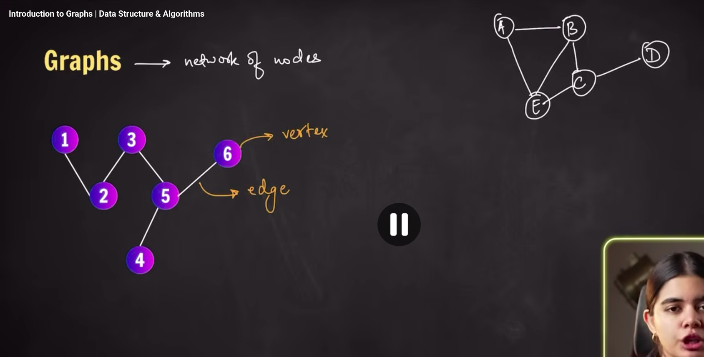
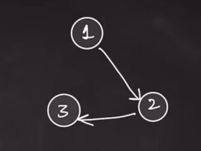
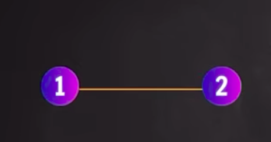
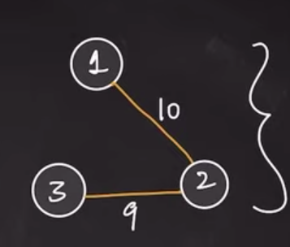
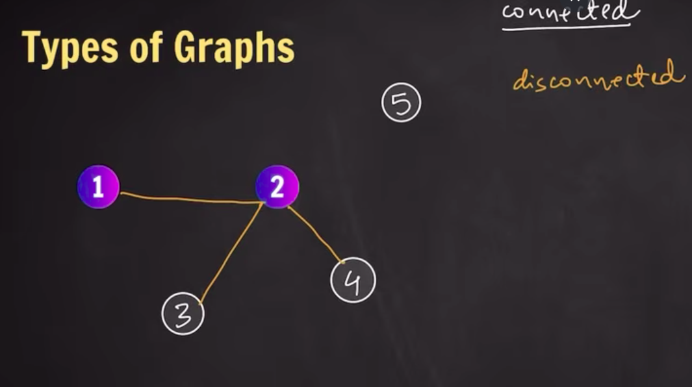
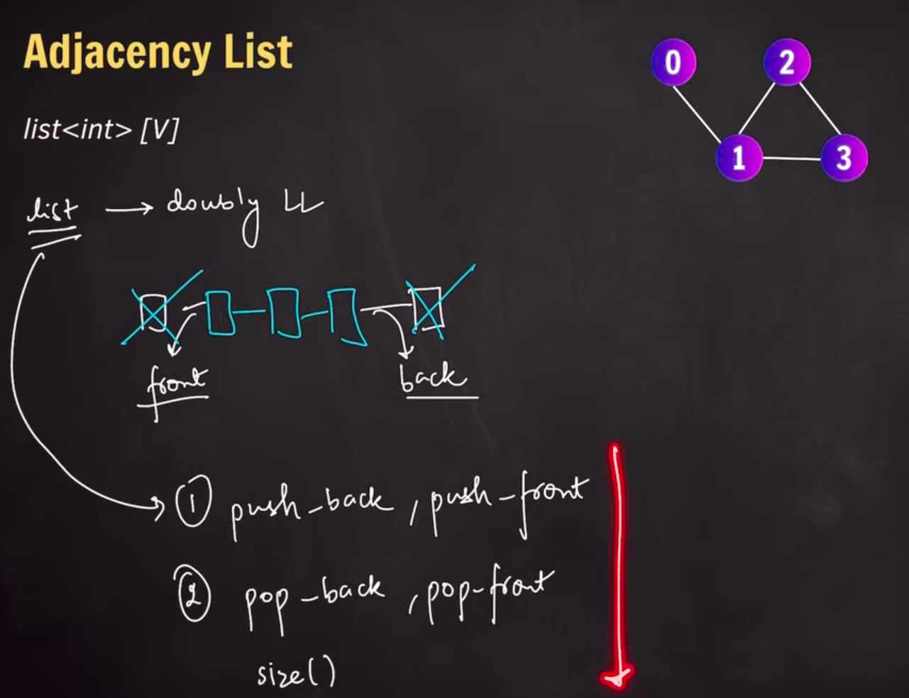
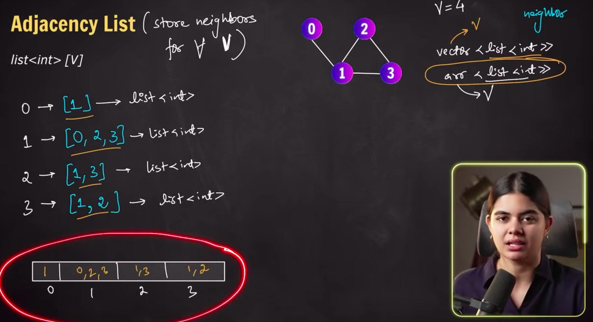
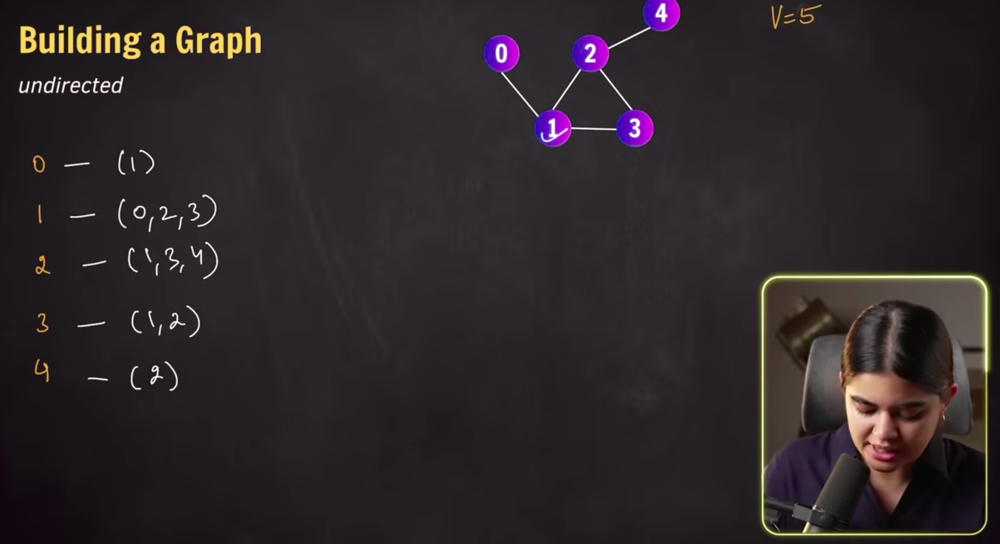

# Garph 

Network of Nodes

- Edges: conneciton between any two nodes
- Vertex or vertices 

## Types of Graphs

### Based on direction of edges

1. Uni directional graphs (Directed Graphs)

2. Bi directional Graph (Undirected Graph)

### Based on weight of edges 

1. Weighted 
- Meaning of weight would depend on the situation
- Weight could be negative 

2. Unweighted Graph
- No weight assiociated with edges 

### Combination of these 
- Undirected unweighted 
- Undirected weighted
- Directed weighted
- Directed unweighted

- Also Disconnected graphs 

## How to build a graph

### 1. Adjacency List 

- List -> Doubly Linked List

- (Store neighbours ∀ V) Store Neighbours for all vertices, where V is vertices 

Note: we are going to use dynamic arrays for the implementation (we could use vectors or static arrays)

>> Undirected Graphs

- [undirected-unweighted-graph.cpp](./09-undirected-unweighted-graph.cpp)

