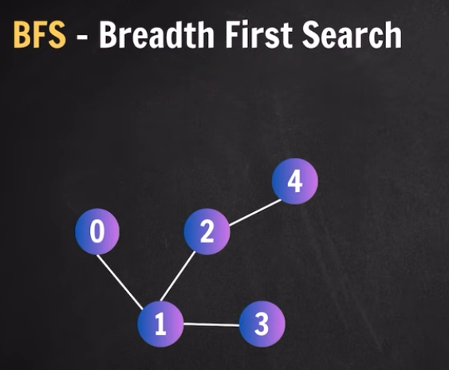
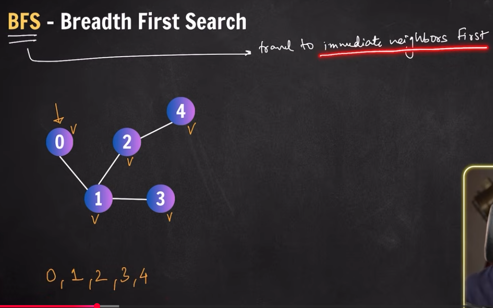
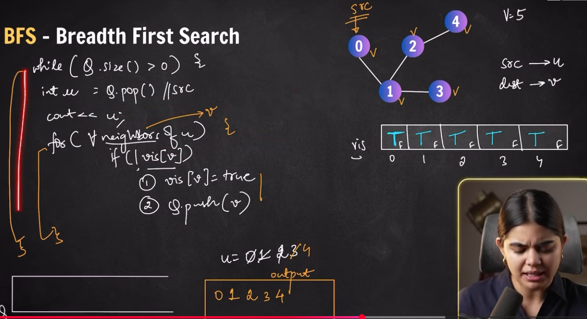

## BFS (Breadth First Search)

https://www.youtube.com/watch?v=scQITTLgFJo&list=PLGjplNEQ1it-0w_PkFtKzH0ZExo6Lvm6R&index=2

- 

- Travel to immediate neighbor first 
- Unlike trees, graphs doesn't have starting point 

- 

- 