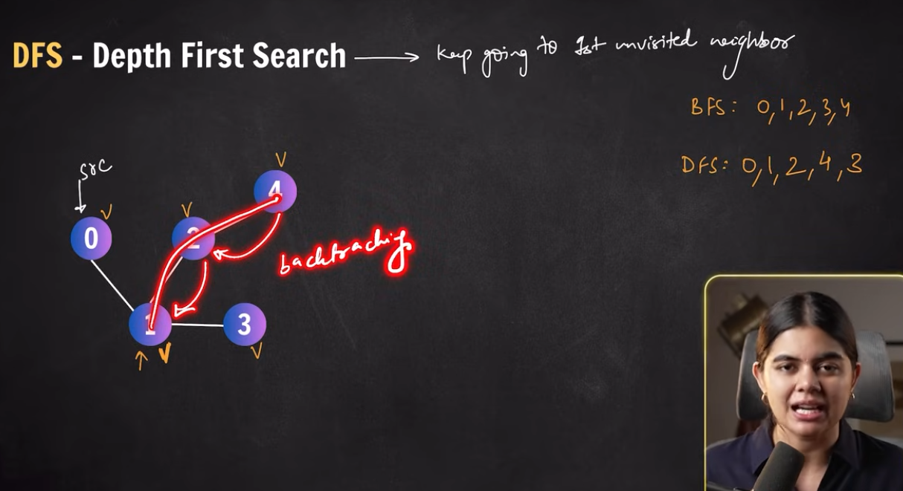

# Depth First Search (DFS)

- Keep going to first unvisited neighbour 

- 

- Could be implemented using recursion, or stack

```python
def dfs(node u, arr<int> visited): 
    print(u)
    visited[u] = true

    for(int v: l[u]): # l: adjacency array, l[u]: list of all neighbours of u
        if(!visited[v]): 
            dfs(v, visited)
```